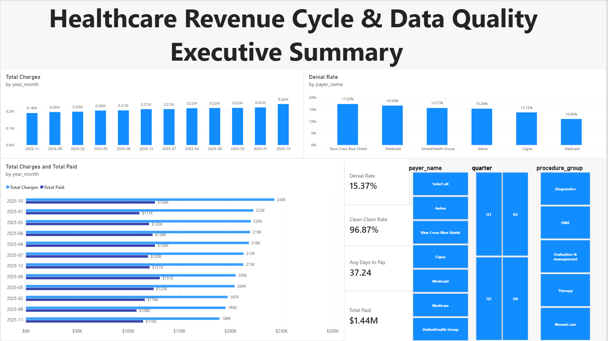
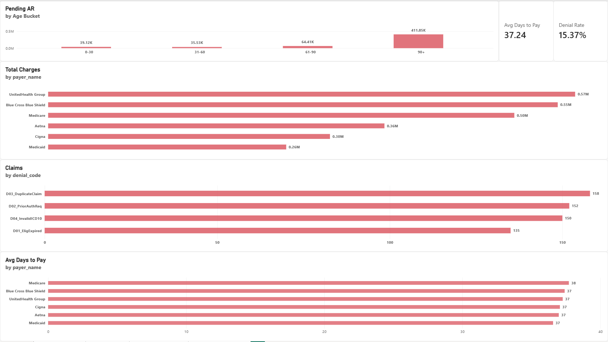
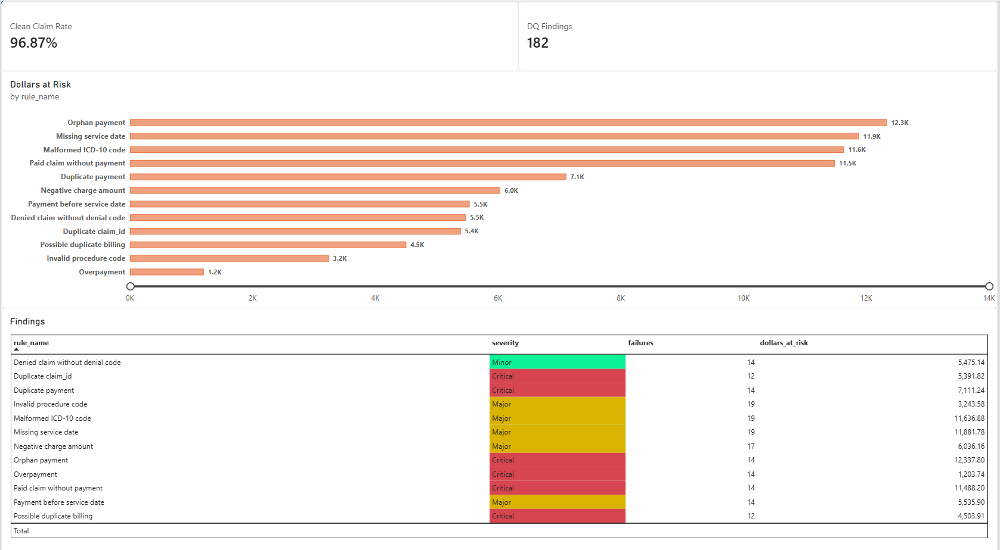
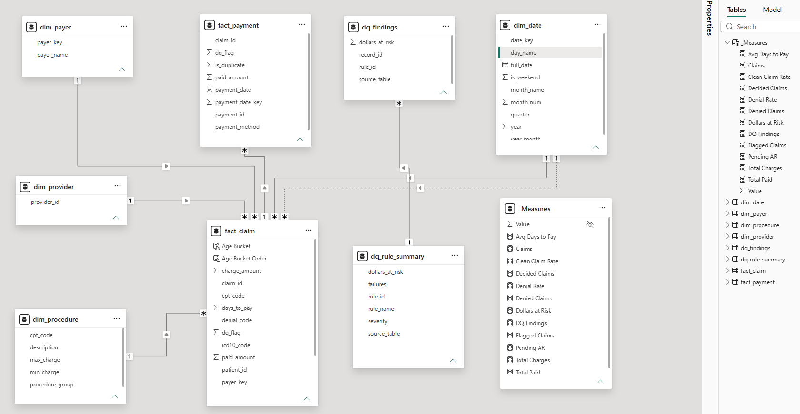
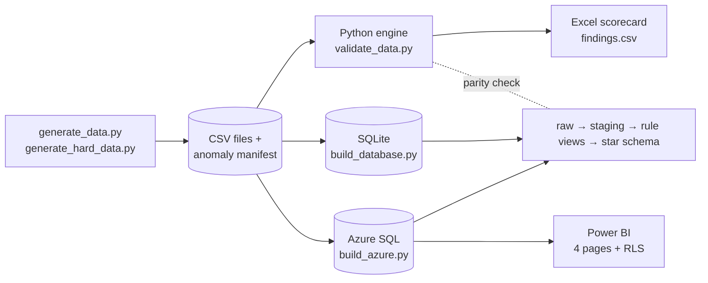

# Healthcare Revenue Cycle: Data Quality Control Engine

An end-to-end data operations project: synthetic healthcare claims go in, twelve documented validation rules audit them in **Python**, **SQLite** and **Azure SQL**, and a four-page **Power BI** report with a data quality scorecard comes out.

> **All data is synthetic.** No real patients, payers or prices. Procedure codes and charge ranges are invented for demonstration. This is a portfolio project, not healthcare experience. See [Limitations](#limitations-read-this).

The design was modelled on a *Senior Data Operations & Analyst* job description (Power BI, Excel, SQL, Python validation, Azure/Fabric). I did not apply for that role. I used it as a realistic specification to build against.

**Read the story behind it:** [CASE_STUDY.md](CASE_STUDY.md)

---

## Headline results

| What | Result |
|---|---|
| Validation rules | **12**, each with ID, severity, logic and business impact |
| Hard test set | 5,064 claim rows, 3,990 payment rows, **182 injected anomalies**, plus **1,366 formatting problems** that must be cleaned but not flagged |
| First validator on hard data | **14.8% precision, 88.5% recall** (925 false alarms, 21 missed errors) |
| After fixes | **182 of 182** anomalies found, **0 false alarms**, 0 missed |
| Cross-platform check | Python, SQLite and Azure SQL flag the **same records and the same dollar totals** for all 12 rules |
| Dollars at risk (hard set) | **$85,846.15** across 182 findings |
| Automated tests | **34** passing |
| Azure SQL build | About 1 minute, free tier |

The 100% score comes with a caveat. I wrote the rules and the data generator, so the score proves the system is wired correctly, not that it would survive real data. The useful number is the **before and after**: the first version failed badly on messy input, and every fix is traceable in the Git history.

---

## Dashboard

| | |
|---|---|
|  |  |
|  |  |

A PDF export of the full report is in [docs/healthcare_dq_report.pdf](docs/healthcare_dq_report.pdf).

Pages: **Executive Summary**, **Revenue Cycle** (AR aging, denials, days to pay), **Data Quality Scorecard**, **Notes**. Row-level security is set up as one static role per payer.

---

## Architecture



**Layers (same design in SQLite and Azure SQL)**

1. **Raw:** CSVs loaded as text, exactly as received. Never modified.
2. **Staging views:** clean spacing, letter case, mixed date formats (`2025-03-01` and `03/01/2025`) and currency text (`$1,234.50`). Formatting noise is **corrected and logged**, not counted as a failure.
3. **Rule views:** twelve views, one per rule, combined into `dq_findings`.
4. **Star schema:** `fact_claim`, `fact_payment`, `dim_payer`, `dim_procedure`, `dim_provider`, `dim_date`. Rows with findings are kept and marked `dq_flag = 1`.

---

## The 12 rules

| ID | Rule | Severity | Why it matters |
|---|---|---|---|
| R01 | Duplicate claim_id | Critical | Double billing |
| R02 | Negative charge amount | Major | Understated revenue |
| R03 | Missing service date | Major | Claim cannot be aged |
| R04 | Invalid procedure code | Major | Payer rejection |
| R05 | Malformed ICD-10 code (format only) | Major | Diagnosis denial |
| R06 | Orphan payment | Critical | Unallocated cash |
| R07 | Overpayment (paid > charge) | Critical | Refund liability |
| R08 | Payment before service date | Major | Impossible timeline |
| R09 | Paid claim without payment | Critical | Revenue not backed by cash |
| R10 | Denied claim without denial code | Minor | Cannot be worked for appeal |
| R11 | Duplicate payment | Critical | Cash overstated |
| R12 | Possible duplicate billing (new claim_id, same patient, provider, procedure, date and charge) | Critical | Double billing under a new number |

Each severity has a failure-rate tolerance (Critical 0.1%, Major 0.5%, Minor 1%). A rule is "in breach" when its failure rate exceeds that. The full catalog is in the scorecard's **Rule Catalog** sheet.

---

## How the validator was tested

1. **Ground truth.** The generator records every injected problem in `anomaly_manifest.csv`, so the validator is scored with precision and recall.
2. **Easy set.** 150 anomalies (3% of 5,000 claims) in otherwise clean data.
3. **Hard set.** Adds near-duplicate billing, claims with two problems at once, formatting noise, and **legitimate look-alikes that must not be flagged** (same-day different procedure, a repeat visit a week later, a payment split into two equal instalments, a payment exactly equal to the charge).
4. **Before and after.** The first validator scored 14.8% precision on the hard set. The fixes were a cleaning layer and rule R12.
5. **Unit tests** per rule on tiny hand-built data, including the look-alike cases.
6. **Parity tests** that compare the SQL rule views with the Python rules.

---

## Tech stack

Python 3.12 (pandas, openpyxl, xlsxwriter, SQLAlchemy, pyodbc, pytest) · SQLite · Azure SQL Database (free tier) · T-SQL · Power BI Desktop (DAX, row-level security) · Excel (scorecard workbook) · Git

---

## Run it yourself

```powershell
git clone <this repo>
cd healthcare-data-ops
python -m venv venv
venv\Scripts\activate
pip install -r requirements.txt

python src\generate_data.py                 # easy set  -> data\
python src\generate_hard_data.py            # hard set  -> data_hard\
python src\validate_data.py --data-dir data_hard --report-dir reports_hard
python src\build_database.py --data-dir data_hard    # SQLite warehouse + parity check
pytest
```

**Azure SQL (optional).** Create a free-tier Azure SQL Database, set `AZURE_SQL_SERVER`, `AZURE_SQL_DATABASE`, `AZURE_SQL_USER` and `AZURE_SQL_PASSWORD` as environment variables (never commit them), install Microsoft's *ODBC Driver 18 for SQL Server*, then:

```powershell
python src\azure_connect_test.py
python src\build_azure.py --data-dir data_hard
```

**Power BI.** Open the report in `powerbi\`, point it at your own database, and refresh. DAX measures are in [powerbi/powerbi_measures.dax](powerbi/powerbi_measures.dax).

---

## Repository layout

```
src/          generators, validation engine, SQLite and Azure builders
sql/          SQLite: staging, rule views, star schema, analysis queries
sql_azure/    the same layers in T-SQL for Azure SQL
tests/        rule tests, SQL parity and star-schema integrity tests
data/         easy test set          data_hard/   hard test set (+ manifests)
reports*/     Excel scorecards and findings
powerbi/      Power BI report and DAX measures
docs/         screenshots, PDF export
```

---

## Limitations (read this)

- **Synthetic data only.** Real claims data is messier, and I have not worked with US healthcare billing. I'm applying general operations reconciliation thinking to a new domain.
- **The validator was tuned on my own generator.** Perfect scores on my test sets do not predict performance on real data, which will contain problems I didn't imagine.
- **Code checks are shallow.** Procedure codes are checked against a 14-code reference table, and ICD-10 is checked for format only, not against the official code set.
- **R12 is a heuristic.** Two genuine claims could match on all five fields. In production it would feed a review queue, not an automatic rejection.
- **Row-level security is static** (one role per payer) and does not filter `dq_findings`, which has no payer link.
- **Not published online.** The report runs in Power BI Desktop. I did not use Microsoft Fabric, so the raw → staging → curated layering is mirrored in Azure SQL instead.
- **No claims about certifications or domain experience** beyond what this repository shows.

---

*Built by Ahmad. Feedback welcome through GitHub issues.*
